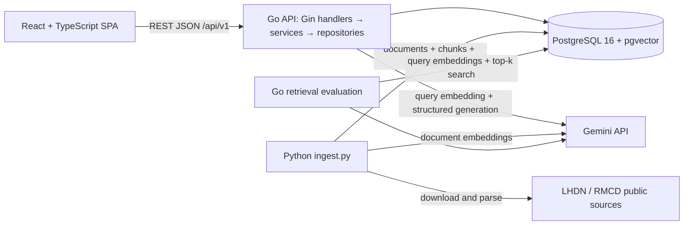
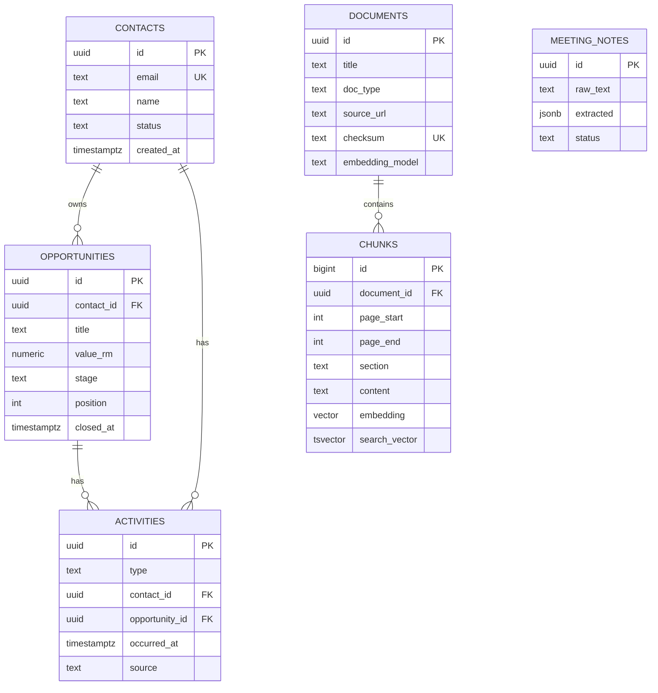

# Architecture

## System overview

The application follows the assessment's Go + PostgreSQL/pgvector option. The React client calls a versioned REST API; the API owns CRM validation, persistence, retrieval, Gemini calls, citation validation, and rate limiting. A separate Python command downloads and indexes official public tax documents.

## Backend structure

- `api/cmd/server`: configuration, database checks, migration startup, route wiring, and graceful shutdown.
- `api/internal/handler`: HTTP binding, validation, response codes, and JSON error envelope.
- `api/internal/service`: CRM transaction orchestration and RAG retrieval/generation policy.
- `api/internal/repository`: parameterized SQL and pgvector operations.
- `api/pkg/gemini`: real Gemini REST calls for query embeddings and structured answer generation.
- `api/migrations`: embedded, versioned SQL migrations.
- `ingest`: offline public-source download, extraction, chunking, and embedding.
- `docs/eval`: retrieval question set and evaluation command/report.

## Data model

`contacts.email` has a case-insensitive unique index. A contact owns opportunities; deleting it cascades to its opportunities and activities. An activity can point to a contact, an opportunity, or both. Opportunity values use `NUMERIC(14,2)` and are serialized as decimal strings. Open stages are `new`, `contacted`, `qualified`, and `proposal`; `won` and `lost` set `closed_at`.

`meeting_notes` is reserved by the initial schema for the optional meeting extractor. The extractor itself is not part of this backend milestone.

## RAG design

### Sources and ingestion

`ingest/sources.yaml` lists five public LHDN/RMCD sources. The script downloads PDFs or HTML, extracts PDF text page-by-page with PyMuPDF or readable HTML with BeautifulSoup, and preserves source URL, title, page range, and section. It splits at about 2,800 characters (roughly 700 tokens) with 350 characters of overlap. Token counts are estimates based on characters divided by four; the chunker prefers paragraph and sentence boundaries.

Every chunk uses the real `gemini-embedding-001` API with `RETRIEVAL_DOCUMENT` and 768 dimensions. Query text uses the same model/dimension with `RETRIEVAL_QUERY`. The database uses a pgvector HNSW cosine index and records the model on each source. Startup rejects a model mismatch; the schema currently fixes vectors at 768 dimensions.

### Online retrieval and answers

`POST /api/v1/rag/ask` validates a question (up to 1,000 characters), optional `doc_type`, and `top_k`. It embeds the question, retrieves up to `RAG_CANDIDATES` nearest chunks, checks the best cosine similarity against `RAG_MIN_SCORE`, and sends at most `RAG_TOP_K` excerpts to Gemini Flash using structured JSON output. Document type filters are applied in SQL before ranking.

The system prompt treats excerpts as untrusted reference data and requires the answer to use only those excerpts. Gemini returns excerpt numbers rather than document metadata. The backend verifies that every used excerpt number exists and appears in the answer, then maps it to the stored title, pages/section, and a short snippet. Similarity below the threshold, a model refusal, or an invalid citation returns the fixed answer: `I could not find this in the ingested documents.` The answer is general information, not legal advice.

The current implementation uses vector-only top-k retrieval. It has a per-client in-memory AI rate limit, request IDs, bounded upstream calls, and retry handling for transient Gemini responses. `RAG_MIN_SCORE=0.55` is an initial value and must be tuned with the evaluation set before making quality claims.

### Evaluation

`docs/eval/golden.json` contains nine answerable source-attribution cases and one out-of-scope question. `go run ./cmd/eval -set ../docs/eval/golden.json` reports source Hit@k and refusal-threshold behavior using live Gemini query embeddings and the same PostgreSQL search repository. The report is intentionally marked pending until a key, database, and imported corpus are available; no hit rate has been measured yet.

## Ports and configuration

Ports are environment-driven. Current defaults avoid the previously occupied ports: API `18080`, PostgreSQL host port `15432`, and the frontend origin `http://localhost:15173`. Change `API_PORT`, `DB_PORT`, and `CORS_ORIGINS` in `.env` to match the actual local setup. The React app should use `VITE_API_BASE_URL=http://localhost:<API_PORT>/api/v1`.

## If I had more time

I would first run and inspect the retrieval evaluation, then tune chunk boundaries and the refusal threshold from the observed misses. After that I would test the SQL paths against a disposable PostgreSQL instance, add the current source version/date to document metadata, and decide from the results whether hybrid search or reranking improves source Hit@k. I would also add request-level query timeouts and a distributed rate limiter before deploying multiple API instances.
